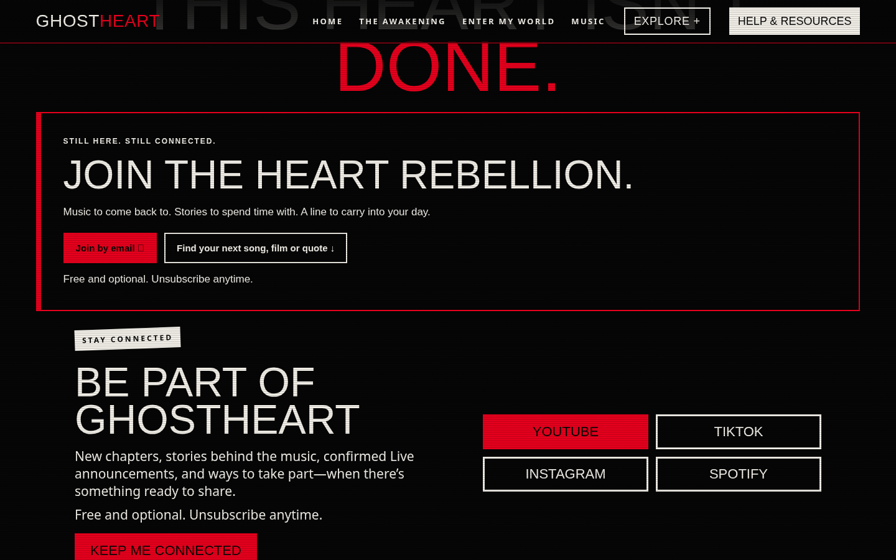
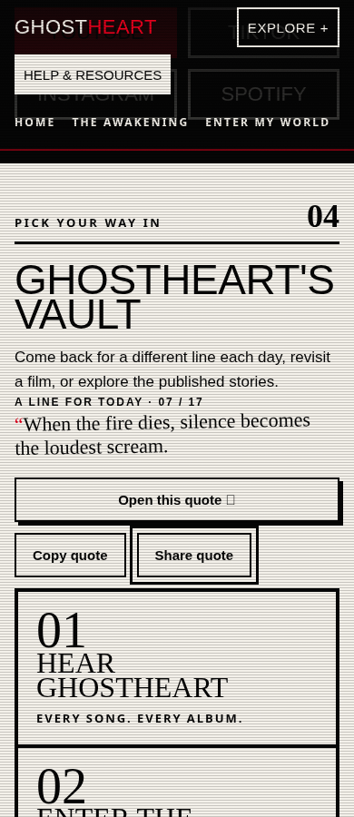

# GhostHeart local homepage candidate

Review candidate only; not merged or deployed. Screenshots are included below for PR review.

- Branch: `codex/homepage-rebellion-candidate-20261020`
- Baseline: `80b83127505956d93cbe3076888369781a10fba7` (PR64).
- Coordination recheck: only open PR32, held blog comments; untouched.
- Actual repository guidance and current workflow used under owner authorization; no replacement instruction files created.

## Bounded changes

Implementation scope: six files: owning homepage LOUD template, generated homepage, homepage-only CSS and JS, focused browser test, and one CI invocation of that test.

Adds an optional Join the Heart Rebellion invitation with the existing signup destination, a jump to existing Vault discovery, truthful return copy, and daily-quote copy/share controls. The permalink is the exact numbered Quote Vault entry selected by the unchanged Chicago-date script. Clipboard failure exposes a selected readonly field with accessible instructions. Native sharing is progressive enhancement; cancellation is handled without copying. With JavaScript disabled the static quote link and signup remain usable.

## Verification

- Full canonical build, followed by another successful build.
- Validator: 66 HTML pages, 274 published files, zero errors.
- Eight Awakening tests; reviewed-site, World, Cruel, compact-homepage and release-boundary checks pass.
- Vault and featured-quote tests pass, including all 17 quote literals and 32 timezone/boundary cases.
- Existing reviewed-site browser suite passes: signup navigation, blog subscription, compact readings, email typography, libraries and menus. No submissions.
- New browser test passes at 320, 390 and 1440 pixels: exact quote and permalink, copy, share fallback, manual clipboard fallback, mocked native sharing/cancellation, keyboard focus, signup anchor, Vault jump, touch targets, no horizontal overflow, no JavaScript errors, and no-JavaScript baseline.
- All original homepage text and links remain in order. Signup section, featured-film section and original inline typography stylesheet are identical to baseline.
- All other generated pages remain unchanged. Two unrelated generator side effects were restored before packaging.
- JavaScript syntax and diff whitespace checks pass.

Screenshots were inspected at mobile and desktop widths. External requests were intercepted during browser tests, so previews use fallback fonts; production font assets and existing typography rules were not changed. Native share outcomes were simulated, not sent to a real recipient. Real email delivery and physical-device share sheets were not tested.

No Fourthwall, merchandise, membership setup, account changes, PR32 work, or deployment occurred. No unresolved implementation blocker.
